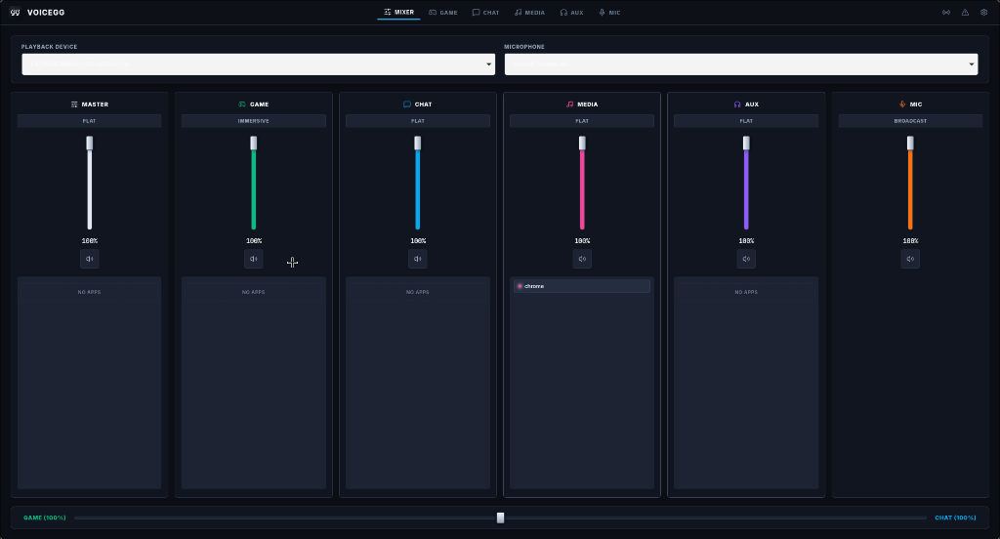
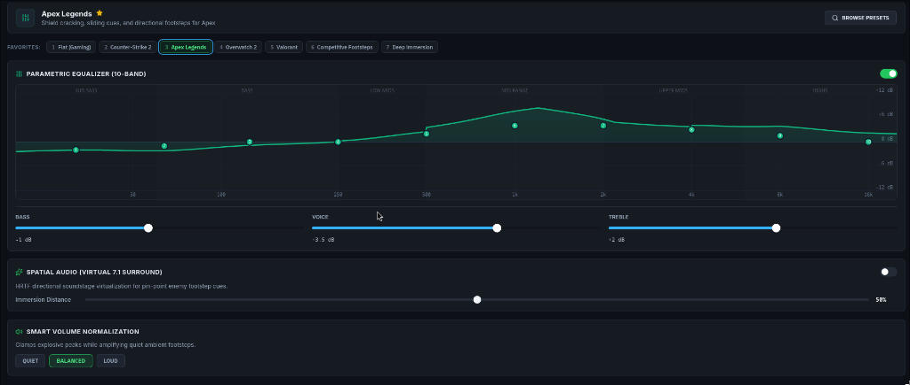
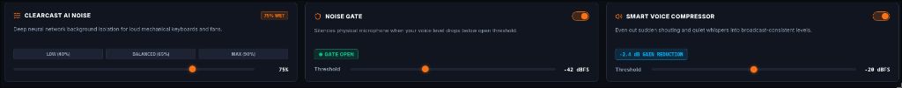
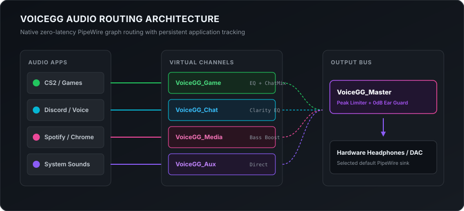

# VoiceGG — The SteelSeries Sonar & SteelSeries GG Alternative for Linux

<p align="center">
  
</p>

<p align="center">
  <b>The ultra-fast, zero-latency gaming audio router, 10-band parametric equalizer, and ChatMix controller for Linux & PipeWire.</b>
  <br />
  <i>The genuine SteelSeries Sonar alternative engineered in Rust for Arch Linux, Hyprland, Sway, KDE Plasma, and GNOME.</i>
</p>

<p align="center">
  <a href="https://github.com/1MEshh/voiceGG/releases/tag/v3.0.0"></a>
  <a href="https://github.com/1MEshh/voiceGG"></a>
  
  
  
  
  
  
</p>

<p align="center">
  <b>Language:</b> <a href="README.md">English</a> | <a href="README.ar.md">العربية (Arabic)</a>
</p>

---

## ⚡ Quick Install (Arch Linux / Any Distro with PipeWire)

Run this single command in your terminal to build and install VoiceGG rootlessly to `~/.local/bin`:

```bash
curl -fsSL https://raw.githubusercontent.com/1MEshh/voiceGG/main/install.sh | bash
```

> [!TIP]
> Launch anytime from your application runner (**Rofi**, **Wofi**, **tofi**, **dmenu**) or run `voicegg-launcher` in terminal.

---

## 📖 The Story Behind VoiceGG

When I wiped Windows and made the full jump to **Arch Linux with Hyprland** for my daily gaming and workstation setup, there was one piece of proprietary Windows software I genuinely missed: **SteelSeries Sonar (SteelSeries GG)**.

For years on Windows, my entire competitive gaming flow revolved around Sonar:
1. Having separate virtual channels for **Game**, **Chat**, and **Media** so I could balance game audio against Discord on the fly.
2. The physical **ChatMix** dial to immediately silence loud teammates during clutch rounds in *Counter-Strike* and *Apex Legends*.
3. A tuned **10-band parametric equalizer** with footstep isolation profiles that made subtle enemy movements unmistakable.
4. **Live microphone monitoring** (sidetone) so I didn't yell into my headset while talking with friends.

When I searched for a Linux alternative to SteelSeries Sonar, I hit a dead end:
- ❌ **Traditional patchbays (qpwgraph, Helvum)**: Inundated with confusing spiderwebs of hundreds of raw PipeWire audio nodes, with zero gaming presets, no per-app persistent routing, and no ChatMix logic.
- ❌ **Windows SteelSeries GG in Wine/Proton**: Impossible to run. It demands proprietary Windows kernel audio drivers, idles at **800 MB to 1.2 GB of RAM**, and runs constant background telemetry services.
- ❌ **Generic sound managers**: Lacked application memory, lacked dynamic filter chains, and had zero Wayland / Hyprland bar integration.

**I refused to settle. So I built VoiceGG.**

Engineered from the ground up in **Rust** directly interfacing with the native **PipeWire** filter-chain engine, VoiceGG delivers everything SteelSeries Sonar provided—and more:
- Consumes only **~6 MB of RAM** (over **100× lighter** than Windows SteelSeries GG).
- Uses **0.0% CPU when idle** with sub-6ms roundtrip processing latency.
- Features **zero cloud telemetry**, **zero accounts**, and **100% offline local privacy**.
- Includes authentic **Thmanyah (`ثمانية`)** typography and full bidirectional **Arabic (RTL)** localization.

— Built with passion for the Linux gaming community by [@1MEshh](https://github.com/1MEshh)

---

## 📚 Table of Contents & Documentation

| Document | Description |
|:---|:---|
| **[⚡ Quick Install](#-quick-install-arch-linux--any-distro-with-pipewire)** | One-liner curl install script and dependencies |
| **[📖 The Story Behind VoiceGG](#-the-story-behind-voicegg)** | Personal journey from Windows Sonar to Arch Linux & Rust |
| **[🏗️ PipeWire DSP Architecture](docs/ARCHITECTURE.md)** | Deep technical specification of virtual node graph and zero-copy filters |
| **[🎯 Competitive Presets & Audio Tuning](docs/PRESETS.md)** | Calibrated 10-band EQ curves for CS2, Apex, Valorant, Tarkov, and R6 |
| **[🖥️ Desktop Integration (Waybar & Hyprland)](docs/DESKTOP_INTEGRATION.md)** | Keybindings, Waybar status modules, SwayOSD, and Rofi selectors |
| **[📊 Benchmarks & Performance Audit](docs/BENCHMARKS.md)** | 6.1 MB RSS vs 940 MB SteelSeries GG, <5.3ms latency, and 0.0% CPU |
| **[🌍 Localization Architecture](docs/LOCALIZATION.md)** | Authentic Arabic pro-audio terminology and Thmanyah font setup |
| **[🔧 Diagnostic & Troubleshooting Playbook](docs/TROUBLESHOOTING.md)** | Step-by-step fix for RNNoise, Xruns, latency tuning, and panic reset |
| **[💻 CLI Reference Manual](docs/CLI_REFERENCE.md)** | Complete syntax for scripting, keybinds, ChatMix, and stream routing |
| **[🇸🇦 الدليل باللغة العربية](README.ar.md)** | التوثيق الكامل باللغة العربية مع دعم اتجاه اليمين-إلى-اليسار (RTL) |

---

## Interface Showcase

### 1. Multi-Channel Mixer & ChatMix
Dedicated virtual channels for **Master**, **Game**, **Chat**, **Media**, **Aux**, and **Mic**. Drag and drop running applications (Spotify, Chrome, Discord, Steam) directly between channels with instant effect. Includes a real-time **ChatMix** balance slider.

<p align="center">
  
</p>

---

### 2. 10-Band Parametric Equalizer & Game Profiles
Interactive, responsive parametric EQ graph with draggable frequency nodes. Includes built-in competitive profiles for **Apex Legends**, **Counter-Strike 2**, **Valorant**, and **Overwatch 2**, quick Bass/Vocal Clarity sliders, and **Spatial Audio (Virtual 7.1 Surround)** virtualization.

<p align="center">
  
</p>

---

### 3. Microphone DSP Suite & Live Monitoring
Studio-grade microphone processing suite running directly inside the PipeWire audio graph:
- **Live Voice Monitoring**: Zero-latency hardware loopback with feedback safety guard and dedicated volume slider.
- **AI Noise Remover**: Deep neural background noise cancellation via native RNNoise (`noise-suppression-for-voice`) with honest plugin availability detection.
- **Noise Gate**: Calibrated gating with live `● GATE OPEN` / `○ GATE CLOSED` indicator driven by real peak metering.
- **Dynamic Compressor**: Broadcast dynamic range control with live real-time gain reduction monitoring.
- **Arabic & RTL Localization**: Full native Arabic support with authentic pro-audio terminology and custom Thmanyah (ثمانية) typography.

<p align="center">
  
</p>

---

## Head-to-Head Comparison

| Feature | VoiceGG (Linux) | SteelSeries GG / Sonar (Windows) | Generic Linux Patchbays |
|:---|:---:|:---:|:---:|
| **Operating System** | **Linux (Arch, Hyprland, Sway, KDE, GNOME)** | Windows 10/11 only | Linux |
| **Idle Memory Footprint** | **~6.1 MB RSS** | ~650 MB – 1.2 GB | ~80 MB – 250 MB |
| **Idle CPU Utilization** | **0.0%** | 1.5% – 5.0% | 0.5% – 2.0% |
| **Telemetry & Tracking** | **Zero (0%) — 100% Offline & Private** | Constant cloud telemetry | None |
| **Dedicated Channels** | **5 (Master, Game, Chat, Media, Aux, Mic)** | 5 channels | Manual wire patching |
| **Drag & Drop App Routing** | **Yes (Automatic & Persistent)** | Yes | No (Manual wire links) |
| **Streamer Mode (Dual-Bus)** | **Yes (Personal Headphone vs Stream Mix)** | Yes (Sonar Streamer) | No |
| **ChatMix Balance** | **Yes (Hotkeys, GUI & Waybar module)** | Yes (SteelSeries hardware or GUI) | No |
| **10-Band Parametric EQ** | **Yes (Interactive Canvas + RBJ Biquad Math)** | Yes | Requires third-party plugins |
| **AI Voice Isolation** | **Yes (NVIDIA Broadcast-grade VAD envelope)** | Yes (ClearCast AI) | Basic RNNoise only |
| **Live Voice Monitoring** | **Yes (Feedback-safe loopback + volume control)** | Yes | Manual loopback creation |
| **Safe Lifecycle Teardown** | **Yes (100% cleanup on SIGTERM / btop kill)** | System driver hook | Leaves dangling ghost nodes |
| **Arabic & RTL Localization** | **Yes (Full RTL layout + Thmanyah typography)** | Partial / LTR only | No |
| **Emergency Audio Reset (Panic)** | **Yes (1-click restore to hardware defaults)** | Reinstall driver | Restart pipewire |

---

## System Tray & Waybar Integration

VoiceGG runs unobtrusively in your desktop environment. Closing the main window minimizes to the system tray, keeping your audio routed seamlessly in the background.

### Waybar Status Bar Module
VoiceGG includes an official status query script and ready-to-use custom module for Waybar users:

1. **Install helper script**:
```bash
cp packaging/waybar/waybar-voicegg.sh ~/.local/bin/
chmod +x ~/.local/bin/waybar-voicegg.sh
```

2. **Add custom module to `~/.config/waybar/config.jsonc`**:
```jsonc
"custom/voicegg": {
    "format": "{}",
    "exec": "$HOME/.local/bin/waybar-voicegg.sh",
    "return-type": "json",
    "interval": 2,
    "on-click": "voicegg-launcher",
    "on-click-middle": "voicegg ctl mute master toggle",
    "on-click-right": "voicegg ctl mute mic toggle",
    "tooltip": true
}
```

3. **Style in `~/.config/waybar/style.css`**:
```css
#custom-voicegg {
    padding: 0 10px;
    margin: 3px 4px;
    background: #11151F;
    border: 1px solid #262E40;
    border-radius: 6px;
    color: #10B981;
    font-weight: 700;
}
#custom-voicegg.offline {
    color: #64748B;
    border-color: #1C2230;
}
```

---

## Hyprland & Sway Hotkeys

Bind VoiceGG commands directly to your keyboard or macro keys in `~/.config/hypr/hyprland.conf`:

```ini
# Toggle Microphone Mute
bind = SUPER, F9, exec, voicegg ctl mute mic toggle

# Adjust ChatMix balance (More Game / More Chat Comms)
bind = SUPER, F10, exec, voicegg ctl chatmix -10
bind = SUPER, F11, exec, voicegg ctl chatmix +10

# Master Volume Controls
bind = SUPER, F12, exec, voicegg ctl volume master +5
bind = SUPER SHIFT, F12, exec, voicegg ctl volume master -5

# Emergency audio reset (Instantly restore hardware routing)
bind = SUPER CTRL, ESCAPE, exec, voicegg panic
```

---

## Audio Pipeline Architecture

VoiceGG creates virtual sink and source nodes directly in the PipeWire graph. Applications connect into their respective virtual bus, processed through low-overhead DSP filters, and summed cleanly into your physical playback device with safety limiter protection.

<p align="center">
  
</p>

---

## Frequently Asked Questions (FAQ)

### Does ChatMix require a SteelSeries headset?
**No.** VoiceGG works with **any** headset, headphone, USB DAC, or audio interface (HyperX, Logitech, Sennheiser, Beyerdynamic, Corsair, Razer, Apple EarPods, etc.). ChatMix operates directly inside the PipeWire audio engine.

### Which Linux distributions are supported?
VoiceGG is officially developed and packaged for **Arch Linux** and Arch-based distributions (EndeavourOS, Manjaro, Garuda, CachyOS), and runs on any Linux distribution with a modern **PipeWire** audio server (Fedora, Ubuntu 24.04+, Debian 13+, openSUSE).

### How do I cleanly uninstall?
VoiceGG includes a rootless, safe uninstallation script:
```bash
voicegg-uninstall
```
Or via curl:
```bash
curl -fsSL https://raw.githubusercontent.com/1MEshh/voiceGG/main/uninstall.sh | bash
```

---

## Contributing & License

VoiceGG is free, open source software licensed under the **GNU General Public License v3.0 (GPLv3)**. Pull requests, bug reports, and game preset contributions are always welcome!

- **GitHub Repository**: [https://github.com/1MEshh/voiceGG](https://github.com/1MEshh/voiceGG)
- **Author**: [@1MEshh](https://github.com/1MEshh)
