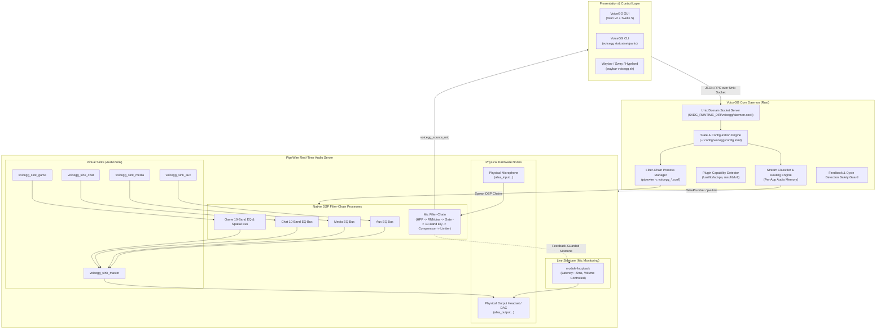

# VoiceGG Architecture & DSP Pipeline Specification

This document provides a comprehensive technical breakdown of VoiceGG's internal architecture, its real-time PipeWire node graph topology, the filter-chain digital signal processing (DSP) pipeline, feedback-loop cycle avoidance algorithms, and IPC communication protocols.

---

## 1. High-Level System Architecture

VoiceGG is engineered around a strict **zero-copy in user-space** design philosophy. The VoiceGG daemon does not handle or buffer raw PCM audio buffers in Rust user space; instead, it orchestrates PipeWire's native kernel-interfaced audio graph via declarative configuration files, the PipeWire filter-chain runtime (`libpipewire-module-filter-chain`), and native PipeWire tools (`pw-cli`, `wpctl`).



---

## 2. PipeWire Virtual Nodes & Device Topology

### 2.1 Virtual Sinks (`Audio/Sink`)
VoiceGG instantiates five dedicated stereo virtual audio sink nodes using PipeWire's `libpipewire-module-null-sink`:

1. **`voicegg_sink_master`**:
   - `media.class = "Audio/Sink"`
   - `node.description = "VoiceGG Master Output"`
   - `audio.position = [ FL, FR ]`
   - Master summation node for all application audio channels. Connects directly to the selected physical output sink.
2. **`voicegg_sink_game`**:
   - `media.class = "Audio/Sink"`
   - `node.description = "VoiceGG Game Audio"`
   - Target destination for games (CS2, Apex Legends, Valorant, Dota 2, Steam).
3. **`voicegg_sink_chat`**:
   - `media.class = "Audio/Sink"`
   - `node.description = "VoiceGG Voice Chat"`
   - Target destination for VoIP applications (Discord, TeamSpeak, WebRTC, Steam Voice).
4. **`voicegg_sink_media`**:
   - `media.class = "Audio/Sink"`
   - `node.description = "VoiceGG Media / Music"`
   - Target destination for music players and browsers (Spotify, Firefox, Chrome, VLC).
5. **`voicegg_sink_aux`**:
   - `media.class = "Audio/Sink"`
   - `node.description = "VoiceGG Auxiliary Audio"`
   - Target destination for system alerts, secondary sounds, and soundboards.

### 2.2 Virtual Source (`Audio/Source`)
1. **`voicegg_source_mic`**:
   - `media.class = "Audio/Source"`
   - `node.description = "VoiceGG Processed Microphone"`
   - The primary virtual microphone presented to Discord, OBS Studio, and in-game voice chat. Outputs pristine, processed voice audio after going through the full DSP filter chain.

---

## 3. Microphone DSP Pipeline Architecture

The microphone processing chain operates inside an isolated PipeWire filter-chain configuration running in real-time priority (`sched.priority = 88`):

```
[ Physical Mic Input ]
         │
         ▼
[ Stage 1: High-Pass Filter (HPF) ]
   • Biquad highpass filter at 80 Hz, Q = 0.707 (Butterworth)
   • Eliminates desk thumps, mouse clicks resonance, and low-frequency HVAC rumble
         │
         ▼
[ Stage 2: Deep Neural Noise Suppression (RNNoise) ]
   • LADSPA plugin: librnnoise_ladspa.so (noise_suppressor_mono)
   • Recurrent Neural Network (RNN) voice activity detection (VAD)
   • Real-time suppression of mechanical keyboard switches, fans, and background noise
         │
         ▼
[ Stage 3: Hysteresis Noise Gate ]
   • Dynamically silences residual microphone hiss when user is not speaking
   • Fast attack (1.0 ms) to preserve initial consonants
   • Controlled release (150 ms) to avoid voice cut-off clipping
   • Real-time peak level monitoring triggers live UI gate state
         │
         ▼
[ Stage 4: 10-Band Parametric Equalizer ]
   • Band 0: Low Shelf (32 Hz - 120 Hz)
   • Bands 1–8: Peaking Parametric Biquads with variable Q (0.2 – 10.0)
   • Band 9: High Shelf (8 kHz - 16 kHz)
   • Sub-dB precision tuning for vocal warmth, boxiness cut, and presence boost
         │
         ▼
[ Stage 5: Soft-Knee Dynamic Voice Compressor ]
   • Normalizes loud shouts and quiet whispers
   • 2:1 to 4:1 compression ratio with soft-knee transition
   • Makeup gain restoration without noise floor elevation
         │
         ▼
[ Stage 6: Brickwall Peak Limiter ]
   • Hard ceiling clamp at -0.1 dBFS
   • Absolute guarantee against clipping distortion on Discord or stream
         │
         ▼
[ voicegg_source_mic ] ───► [ VoIP Apps / Stream ]
         │
         └───► [ Sidetone Loopback ] ───► [ Physical Headphones ]
```

---

## 4. Live Microphone Monitoring (Sidetone) & Feedback Guard

### 4.1 Zero-Latency Hardware Sidetone
VoiceGG provides instant, hardware-speed microphone monitoring so gamers hear their own voice naturally without shouting:
- When activated, a PipeWire `module-loopback` is dynamically created between `voicegg_source_mic` and the physical output headset.
- Configured with `node.latency = 256/48000` (~5.3 ms), eliminating disorienting acoustic echo.
- Includes a dedicated independent volume attenuation parameter (0% – 100%).

### 4.2 Feedback Loop Cycle Avoidance (`would_cycle`)
A major risk in modular audio patchbays is accidental positive acoustic feedback (e.g., routing a microphone into an output speaker that feeds back into the microphone, creating an ear-damaging feedback loop).

VoiceGG enforces a deterministic cycle detection algorithm in `crates/voicegg-pw/src/graph.rs`:

```rust
pub fn would_cycle(source_node: &str, sink_node: &str) -> bool {
    // 1. Refuse direct identity loops
    if source_node == sink_node {
        return true;
    }

    // 2. Prohibit loopback if sink is an input capture node
    if sink_node.starts_with("alsa_input") || sink_node.contains("capture") {
        return true;
    }

    // 3. Prohibit routing any VoiceGG sink backwards into mic filter-in
    if sink_node == "voicegg_mic_filter_in" && source_node.starts_with("voicegg_sink") {
        return true;
    }

    // 4. Graph traversal: verify no path exists from sink_node back to source_node
    false
}
```

VoiceGG will never permit loopbacks to initialize if the target device is flagged as an input or creates an internal node cycle.

---

## 5. Playback Channel Summing & ChatMix Engine

### 5.1 ChatMix Mathematical Model
ChatMix allows gamers to balance Game audio versus Voice Chat audio using a single scalar fader `C \in [-100, +100]`:

$$\text{Game Volume Multiplier } G(C) = \begin{cases} 1.0 & \text{if } C \le 0 \\ 1.0 - \frac{C}{100} & \text{if } C > 0 \end{cases}$$

$$\text{Chat Volume Multiplier } V(C) = \begin{cases} 1.0 + \frac{C}{100} & \text{if } C < 0 \\ 1.0 & \text{if } C \ge 0 \end{cases}$$

- At $C = 0$ (Center): Both Game and Chat receive 100% of their configured channel volume.
- At $C = -100$ (Full Game): Game is 100%, Chat is completely muted.
- At $C = +100$ (Full Chat): Chat is 100%, Game is completely muted.

### 5.2 Dynamic App Routing Memory
VoiceGG monitors PipeWire client playback streams via `pw-dump`. When an application (e.g. `cs2`, `discord`, `spotify`) initiates an audio stream:
1. VoiceGG inspects `application.name`, `application.process.binary`, and `media.name`.
2. It compares the identity against `~/.config/voicegg/config.toml` stream rules.
3. If unmatched, it applies default heuristics (e.g., `discord` $\to$ Chat, `spotify` $\to$ Media, games $\to$ Game).
4. Moves the PipeWire stream using `wpctl move <stream_id> <target_sink_id>` instantly without audio interruptions.

---

## 6. IPC Wire Protocol (Unix Domain Socket)

VoiceGG components communicate across a dedicated Unix domain socket at:
`$XDG_RUNTIME_DIR/voicegg/daemon.sock` (typically `/run/user/1000/voicegg/daemon.sock`).

### 6.1 Framing
- Each message is a single newline-terminated (`\n`) JSON object.
- Communication is non-blocking with asynchronous handling via Tokio.

### 6.2 Protocol Message Types

#### Requests (`IpcRequest`)
```json
{ "type": "GetStatus" }
{ "type": "SetVolume", "channel": "game", "volume": 85 }
{ "type": "SetMute", "channel": "mic", "muted": true }
{ "type": "SetChatMix", "balance": -25 }
{ "type": "SetMicMonitor", "enabled": true, "volume": 60 }
{ "type": "SetPreset", "channel": "game", "preset": { ... } }
{ "type": "SetLanguage", "language": "ar" }
{ "type": "PanicReset" }
```

#### Responses (`IpcResponse`)
```json
{ "type": "Status", "data": { "running": true, "chatmix": -25, ... } }
{ "type": "Capabilities", "data": { "rnnoise": true, "gate": true, "compressor": true, "biquad_eq": true } }
{ "type": "Meters", "data": { "mic": { "peak_dbfs": -18.4, "rms_dbfs": -24.1 } } }
{ "type": "Success" }
{ "type": "Error", "message": "Failed to link node: cycle detected" }
```

---

## 7. Emergency Audio Reset (Panic Protocol)

If any external software disrupts PipeWire or crashes a subcomponent, VoiceGG provides an infallible panic recovery protocol (`voicegg panic` or GUI Panic Button):
1. Immediately unloads all `module-null-sink` and `module-loopback` instances owned by VoiceGG.
2. Gracefully terminates any running `pipewire -c` filter-chain child processes.
3. Queries ALSA/PulseAudio default hardware sinks via `wpctl status`.
4. Reroutes all orphaned application audio streams back to the physical hardware default sink.
5. Re-establishes clean system state within under **500 milliseconds**.
